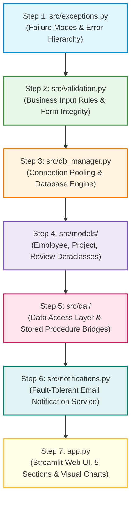

# Enterprise Employee Analytics & Data Warehouse System
## Complete Codebase Walkthrough, Architectural Guide & Reading Sequence

---

## 1. Executive Summary & Purpose of this Guide

This document is written specifically for **new university graduates, junior software engineers, and students preparing for a project defense (viva / technical interview)**. It provides a complete, easy-to-understand breakdown of every single Python file in the codebase:
- **What each file does in plain English.**
- **Categorization of functions** into `[CORE / IMPORTANT FUNCTION]` vs `[HELPER / UTILITY FUNCTION]`.
- **The exact recommended sequence** to read the files so you build understanding step-by-step.
- **In-depth explanation of `app.py`**, detailing its **5 main sections** and the exact mechanics of **how every chart is constructed in Plotly**.

---

## 2. Recommended Reading Sequence (Step-by-Step)

When exploring an enterprise data warehousing and web application project, reading files at random causes confusion. The optimal order starts at low-level error handling, moves up through data modeling and database access, and finishes at the user interface:



### Why this sequence matters:
1. **`exceptions.py` (Step 1)**: Teaches you *how things can fail* so you recognize error-handling patterns everywhere else.
2. **`validation.py` (Step 2)**: Teaches you the *business constraints* (name regex, 10-digit phone numbers, role lengths).
3. **`db_manager.py` (Step 3)**: Teaches you *how Python talks to MySQL* via connection pools and atomic transactions.
4. **`models/` (Step 4)**: Teaches you the *data objects* (`Employee`, `Project`, `Review`) used in memory.
5. **`dal/` (Step 5)**: Teaches you the *SQL queries, dual-writes, and Slowly Changing Dimension (SCD2) procedures*.
6. **`notifications.py` (Step 6)**: Teaches you *how external mail services run safely* without crashing the app.
7. **`app.py` (Step 7)**: Shows how everything combines into an interactive web interface.

---

## 3. Detailed File-by-File Breakdown (`src/`)

---

### Step 1: `src/exceptions.py`
- **Location**: `src/exceptions.py`
- **Role**: Custom Typed Error Hierarchy
- **What it does**: Instead of throwing generic Python `Exception`s, this file defines custom, strongly-typed errors. This allows callers (like `app.py`) to catch specific errors and display clean, friendly banners to end-users instead of crashing with a messy Python traceback.

#### Hierarchy & Error Categories:
1. **`AppError(Exception)`** `[BASE ROOT EXCEPTION]`
   - The top-level ancestor of every custom exception in the project. Catching `AppError` in Streamlit guarantees that no internal business failure crashes the session.
2. **`DatabaseError(AppError)`** `[DATABASE INFRASTRUCTURE ERRORS]`
   - `ConnectionFailedError`: Raised when MySQL is unreachable, the port is closed, or credentials fail.
   - `QueryError`: Raised when SQL execution fails (syntax error, driver disconnect).
3. **`DataAccessError(AppError)`** `[DATA ACCESS LAYER ERRORS]`
   - `NotFoundError`: Raised when an entity ID (e.g., `EMP-9999999`) does not exist in the database.
   - `DuplicateRecordError`: Raised when an `INSERT` collides with a `UNIQUE` key (duplicate email, duplicate assignment on same start date, or duplicate appraisal on same day).
   - `ValidationError`: Raised when user input violates validation regexes or numeric constraints. Safe to render directly in red UI banners.
   - `DataWarehouseError`: Raised when an OLAP stored procedure rejects an operation with MySQL `SIGNAL SQLSTATE '45000'`.

---

### Step 2: `src/validation.py`
- **Location**: `src/validation.py`
- **Role**: Input Sanitation & Form Integrity Accumulator
- **What it does**: Validates and cleans user input gathered from Streamlit text boxes and number fields before data reaches MySQL. It mirrors column definitions from `03_create_oltp.sql`.

#### Important Functions:
- **`validate_name(value, field_name)`** `[CORE / IMPORTANT FUNCTION]`
  - *Inputs*: Raw name string (e.g., `"Aarti Sharma"`), field name label.
  - *Outputs*: Cleaned name string.
  - *Logic*: Uses Unicode regex `NAME_RE` (`^[^\W\d_](?:[^\W\d_]|[ .'\u2018\u2019-])*$`) to support international names (e.g. José, Müller, D'Alia) while blocking numeric and malicious injection strings.
- **`validate_email(value, required=True)`** `[CORE / IMPORTANT FUNCTION]`
  - *Inputs*: Raw email string.
  - *Outputs*: Lowercased, stripped email string.
  - *Logic*: Applies RFC-compliant regex `EMAIL_RE` to ensure valid `user@domain.tld` format.
- **`validate_phone(value, required=True)`** `[CORE / IMPORTANT FUNCTION]`
  - *Inputs*: Raw phone string.
  - *Outputs*: Cleaned 10-digit numeric string.
  - *Logic*: Enforces exact 10-digit Indian mobile format (`^[6-9][0-9]{9}$`). Prevents database padding bugs in `CHAR(10)` columns.
- **`validate_role(value, field_name)`** `[CORE / IMPORTANT FUNCTION]`
  - *Inputs*: Job title string (e.g., `"Senior Analyst (Actuarial)"`).
  - *Outputs*: Cleaned role string.
  - *Logic*: Validates against `ROLE_RE` and ensures length $\le 100$ characters.
- **`FormValidator`** `[CORE COMPONENT - FORM INTEGRITY ACCUMULATOR]`
  - *What it is*: A class that collects form validation errors across multiple fields simultaneously (`validator.check("Email", validate_email, email)`).
  - *Why it's important*: Without this, a user would fix one field, click submit, get an error on the second field, fix it, click submit, and get an error on the third. `FormValidator` returns all errors in a dictionary (`errors`) so Streamlit renders all issues at once.

#### Helper Functions:
- **`clean(value)`** `[HELPER / UTILITY FUNCTION]`: Trims whitespace and strips ASCII control characters (0-31 and DEL).
- **`validate_text(value, field_name, max_length)`** `[HELPER / UTILITY FUNCTION]`: Checks basic text bounds.
- **`validate_number(value, field_name, minimum, maximum)`** `[HELPER / UTILITY FUNCTION]`: Checks numeric boundaries.
- **`validate_age(value)`** `[HELPER / UTILITY FUNCTION]`: Enforces $\text{Age} \in [18, 70]$.

---

### Step 3: `src/db_manager.py`
- **Location**: `src/db_manager.py`
- **Role**: Thread-Safe Singleton Connection Pool & Execution Engine
- **What it does**: Provides the low-level foundation for connecting Python to MySQL via SQLAlchemy.

#### Core Architectural Concepts:
1. **The Streamlit Rerun Problem**: In Streamlit, every user click or slider adjustment re-executes the entire script from top to bottom. If you opened a database connection normally, every click would open a new socket until MySQL reached its connection limit.
2. **The Singleton Pattern Solution**: `DatabaseConnection` guarantees that only **one engine and connection pool** exists per Python process using a class-level thread lock and double-checked locking.

#### Important Functions & Classes:
- **`DatabaseConnection`** `[CORE INFRASTRUCTURE CLASS - THREAD-SAFE SINGLETON]`
  - `__new__(cls)` `[CORE]`: Enforces single instance creation across multiple threads.
  - `engine` `[CORE]`: Lazily creates the SQLAlchemy engine with pool recycling:
    - `pool_size=5`: Keeps 5 persistent connections open.
    - `pool_pre_ping=True`: Sends a quick test ping before handing a connection to Python, automatically healing if MySQL restarted.
    - `pool_recycle=3600`: Recycles sockets every hour to prevent MySQL timeout drops.
  - `query_frame(sql, params)` `[CORE]`: Runs a `SELECT` statement and returns a Pandas DataFrame with decimals coerced to floats.
  - `execute(sql, params)` `[CORE]`: Runs a single `INSERT`/`UPDATE`/`DELETE` inside an atomic transaction.
  - `call_procedure(procedure, *args)` `[CORE]`: Runs stored procedures and extracts the last meaningful non-empty result set.
  - `transaction()` `[CORE]`: Context manager (`with db.transaction() as conn:`) ensuring multi-step writes commit together or roll back on failure.
- **`translate_db_error(exc)`** `[CORE / IMPORTANT FUNCTION]`
  - *Inputs*: Raw `SQLAlchemyError`.
  - *Outputs*: Typed `AppError` (`DataWarehouseError`, `DuplicateRecordError`, or `QueryError`).
  - *Logic*: Uses regex `_DRIVER_ERROR` to parse MySQL driver error codes. MySQL error `1644` (from stored procedure `SIGNAL SQLSTATE '45000'`) is translated into a clean `DataWarehouseError` with the procedure's exact error message.
- **`BaseDataManager`** `[CORE ARCHITECTURAL BASE CLASS]`
  - The base class inherited by all manager classes (`EmployeeManager`, `ProjectManager`, etc.). Wraps read and write helpers: `fetch_frame()`, `fetch_one()`, `fetch_value()`, `run()`, and `run_many()`.

#### Helper Functions:
- **`_coerce_decimals(frame)`** `[HELPER / UTILITY FUNCTION]`: PyMySQL returns MySQL `DECIMAL` columns as Python `Decimal` objects, which Pandas treats as generic `object` dtype. This breaks sorting, `.nsmallest()`, and Plotly graphs. This helper converts all Decimal columns to native `float64` at the database boundary.
- **`ping()`** `[HELPER / UTILITY FUNCTION]`: Executes `SELECT 1 AS ok` to check database health for the UI sidebar badge.

---

### Step 4: Domain Models (`src/models/`)
- **Location**: `src/models/employee.py`, `project.py`, `review.py`, `__init__.py`
- **Role**: Pure Business Domain Entities (Dataclasses)
- **What they do**: Represent the system's core business entities in memory. They contain zero SQL queries, remaining completely decoupled from the database.

#### 4a. `src/models/employee.py`
- **`Employee`** `[CORE DOMAIN ENTITY CLASS]`:
  - Mirrors columns in the OLTP `employees` table: `employee_id`, `first_name`, `last_name`, `email`, `hire_date`, `department_id`, `job_role`, `monthly_income`, `employment_status`, `job_level`, `manager_employee_id`.
  - `from_row(cls, row)` `[CORE]`: Factory method converting raw database dictionary rows into strongly-typed `Employee` objects with date/float parsing.
  - `validate(self)` `[CORE]`: Validates all 10 domain invariants (names, phone, salary bounds, termination date $\ge$ hire date) before persistence.
  - `apply_department_change(new_dept_id)` `[CORE]`: Updates department in memory ahead of SCD2 database processing.
  - `tenure_years`, `annual_income`, `full_name`, `is_active` `[HELPER]`: Computed helper properties.

#### 4b. `src/models/project.py`
- **`Project`** `[CORE DOMAIN ENTITY CLASS]`:
  - Mirrors columns in `projects`: `project_id`, `project_name`, `project_type`, `project_start_date`, `project_end_date`, `project_status`, `project_manager_employee_id`.
  - `validate(self)` `[CORE]`: Enforces project dates, status constraints, and name lengths.
  - `complete(on_date)` `[CORE]`: Sets status to `'Completed'` and stamps the end date.
  - `is_overallocated`, `average_allocation` `[HELPER]`: Workload analytics helpers.

#### 4c. `src/models/review.py`
- **`Review`** `[CORE DOMAIN ENTITY CLASS]`:
  - Mirrors columns in `performance_reviews`: `review_id`, `employee_id`, `review_date`, `rating` (1-5), `performance_score` (0-100), `promotion_recommendation`, `reviewer_employee_id`.
  - `validate(self)` `[CORE]`: Ensures scores and ratings are within bounds.
  - `suggest_promotion(self)` `[CORE]`: Implements the company promotion rule: returns `True` if $\text{Rating} \ge 4 \land \text{PerformanceScore} \ge 75$.
  - `quality_band` `[HELPER]`: Maps performance scores into qualitative tiers (`Excellent`, `Good`, `Satisfactory`, `Needs Improvement`).

---

### Step 5: Data Access Layer (`src/dal/`)
- **Location**: `src/dal/employee_dal.py`, `project_dal.py`, `review_dal.py`, `analytics_dal.py`, `__init__.py`
- **Role**: Data Persistence, SQL Queries, and Stored Procedure Bridges
- **What it does**: Inherits from `BaseDataManager` and performs all SQL execution, transactions, and stored procedure calls.

#### 5a. `src/dal/employee_dal.py`
- **`add_employee(employee)`** `[CORE / IMPORTANT FUNCTION]`:
  - **Atomic Dual-Write**: Inserts the new employee record into the OLTP `employees` table AND calls `sp_apply_employee_change(:employee_id, :hire_date, 0)` to create their first historical record in `dim_employee` inside the **same database transaction**. Both succeed, or both roll back.
- **`change_department(employee_id, department_id, change_date)`** `[CORE / IMPORTANT FUNCTION]`:
  - **SCD Type 2 Transfer**: Updates `employees.DepartmentID` in OLTP and executes `sp_apply_employee_change`. This closes the current version in `dim_employee` (`EffectiveEndDate = change_date - 1`, `IsCurrent = 0`) and inserts a brand new version (`EffectiveStartDate = change_date`, `EffectiveEndDate = '9999-12-31'`, `IsCurrent = 1`).
- **`list_employees(...)`** `[CORE / IMPORTANT FUNCTION]`:
  - Retrieves paginated employees with `recent_first=True` (`ORDER BY EmployeeID DESC`). This ensures newly onboarded employees (e.g. `EMP-0015001`) appear immediately at the top of pickers rather than being hidden behind older seeded records.
- **`employee_history(employee_id)`** `[CORE / IMPORTANT FUNCTION]`:
  - Queries `dim_employee` to fetch the complete point-in-time audit trail of an employee's career (all past departments, roles, and salaries).
- **`delete_employee(employee_id)`** `[CORE / IMPORTANT FUNCTION]`:
  - Deletes an employee from both OLTP and `dim_employee` after confirming they have no dependent reviews or project assignments.

#### 5b. `src/dal/project_dal.py`
- **`add_assignment(employee_id, project_id, role, allocation, start_date)`** `[CORE / IMPORTANT FUNCTION]`:
  - **Cumulative Capacity Guard**: Calculates `SUM(AllocationPercentage)` for the employee across all active projects. If the new allocation pushes their total over **100%**, it rejects the booking with a `ValidationError`. Also checks for duplicate bookings on the same start date.
- **`add_project(project)`** `[CORE / IMPORTANT FUNCTION]`: Validates and inserts a new project into OLTP.
- **`end_assignment(assignment_id, end_date)`** `[CORE / IMPORTANT FUNCTION]`: Sets assignment status to `'Completed'`, releasing employee bandwidth.

#### 5c. `src/dal/review_dal.py`
- **`add_review(review)`** `[CORE / IMPORTANT FUNCTION]`:
  - **1-Per-Day Constraint**: Checks `COUNT(*)` for `(EmployeeID, ReviewDate)`. Rejects multiple appraisal submissions for the same employee on the same calendar day.
- **`list_reviews(...)`** `[CORE / IMPORTANT FUNCTION]`: Returns reviews joined with employee and department names.
- **`recent(days, limit)`** `[HELPER / UTILITY FUNCTION]`: Queries reviews from the last $N$ days for recency dashboards.

#### 5d. `src/dal/analytics_dal.py`
- **`kpi_summary()`** `[CORE / IMPORTANT FUNCTION]`:
  - Reads `vw_kpi_summary` to provide the headline metrics on the Executive Dashboard.
- **`performance_trend_yoy()`** `[CORE / IMPORTANT FUNCTION]`:
  - Reads `vw_performance_trend_yoy`, which uses SQL window function `LAG()` to calculate Year-over-Year score and volume changes.
- **`top_performers(department, top_n, min_reviews)`** `[CORE / IMPORTANT FUNCTION]`:
  - Reads `vw_top_performers_by_department`, which calculates leaderboards using SQL `DENSE_RANK() OVER (PARTITION BY DepartmentName ORDER BY avg_score DESC)`.
- **`attrition_risk(...)`** `[CORE / IMPORTANT FUNCTION]`:
  - Reads `vw_attrition_risk`, blending performance scores, appraisal ratings, and tenure into composite risk scores.
- **`project_bottlenecks(...)`** `[CORE / IMPORTANT FUNCTION]`:
  - Reads `vw_project_bottlenecks`, identifying projects with total allocation $> 1000\%$ and below-average performance scores.
- **`reconciliation()`** `[CORE / IMPORTANT FUNCTION]`:
  - Evaluates the **7 data warehouse invariants** in `vw_oltp_dw_reconciliation` to verify zero drift between OLTP and DW.
- **`sync_warehouse(lookback_days)`** `[CORE / IMPORTANT FUNCTION]`:
  - Incremental ETL sync executing `sp_load_dim_employee_delta`, `sp_load_fact_delta`, and `sp_repair_dim_employee_versions`.
- **`run_full_refresh()`** `[CORE / IMPORTANT FUNCTION]`:
  - Complete end-to-end rebuild executing `sp_load_oltp_master` then `sp_load_dw_master`.

---

### Step 6: `src/notifications.py`
- **Location**: `src/notifications.py`
- **Role**: Asynchronous Email Notification Service (SMTP)
- **What it does**: Dispatches plain-text email alerts to employees when they are assigned to a project.

#### Important Architectural Principles:
1. **Never Fails Transactions**: `notify_assignment()` catches all network, authentication, and syntax errors, returning a structured `NotificationResult`.
2. **Post-Commit Execution**: The project allocation is committed to MySQL *before* the email is sent. If SMTP is offline, the assignment still succeeds, and the user is shown an informational banner rather than an application crash.

#### Important Functions:
- **`AssignmentNotifier.notify_assignment(...)`** `[CORE / IMPORTANT FUNCTION]`: Composes and dispatches the allocation email via SMTP.
- **`MailSettings.load(get)`** `[CORE / IMPORTANT FUNCTION]`: Loads SMTP credentials from `.env` or Streamlit `secrets.toml`.
- **`NotificationResult`** `[CORE VALUE OBJECT]`: Stores delivery outcome (`sent`, `invalid_address`, `not_configured`, `failed`).

---

## 4. Deep Dive: `app.py` & The 5 Main UI Sections

`app.py` is the top-level Streamlit web application. It connects the user interface to the Data Access Layer and renders analytics dashboards.

### Utility & State Functions in `app.py`:
- **`resolve_database_url()`** `[CORE]`: Finds MySQL connection URI in `st.secrets` $\to$ `.env` $\to$ default.
- **`get_managers()`** `[CORE]`: Decorated with `@st.cache_resource` so manager instances and connection pools persist across script reruns.
- **`employee_picker()`** `[CORE]`: Interactive search bar and dropdown that orders by `EmployeeID DESC` (`recent_first=True`) so newly created employees are immediately selectable.
- **`guarded_input()`** `[CORE]`: Sanitizes keystrokes (e.g. strips non-digits from phone fields) and displays inline validation errors on focus loss.
- **`show_action_error()`** `[CORE]`: Form error catcher that extracts clean messages from `ValidationError` and `DuplicateRecordError` without showing raw tracebacks.

---

### Section 1: Executive Dashboard (`PAGE_HOME`)

#### Purpose:
Provides executive leadership with high-level KPIs and four in-depth analytical charts powered by the Data Warehouse Star Schema.

#### Headline Metric Cards:
Built using `st.columns(5)` and `st.metric()`:
1. **Total Employees**: Total records from `vw_kpi_summary.total_employees`.
2. **Active Employees**: Currently employed headcount (`active_employees`).
3. **Attrition Rate**: Percentage of terminated employees with inverse delta indicator (`attrition_pct`).
4. **Average Salary**: Company-wide monthly average base salary formatted in INR (`avg_salary`).
5. **Average Performance Score**: Company-wide benchmark appraisal score (`avg_score`).

---

#### 📊 Chart 1: Year-over-Year Performance Trend
- **What it shows**: How the company's average appraisal performance score evolves year-over-year.
- **Underlying SQL View**: `vw_performance_trend_yoy` (uses SQL `LAG()` to compute prior-year differences).
- **Plotly Construction**:
  ```python
  figure = px.line(
      trend,
      x="review_year",
      y="avg_score",
      markers=True,
      hover_data={"review_count": True, "avg_rating": ":.2f", "yoy_score_change": ":.2f"},
      labels={"review_year": "Year", "avg_score": "Avg performance score"},
  )
  figure.update_traces(line=dict(width=3, color=PALETTE[0]))
  ```
- **Technical Breakdown**:
  - **Chart Type**: Line Chart with circle markers (`px.line`).
  - **X-Axis**: `review_year` (calendar years: 2020, 2021, ...).
  - **Y-Axis**: `avg_score` (mean performance score out of 100).
  - **Hover Tooltip**: Displays review volume, average rating out of 5, and absolute score change (`yoy_score_change`).
  - **Companion Table**: A Pandas DataFrame rendered alongside with formatted percentage change columns.

---

#### 📊 Chart 2: Top Performers Leaderboard by Department
- **What it shows**: The highest-ranking employees per department, filterable by department and review volume threshold.
- **Underlying SQL View**: `vw_top_performers_by_department` (uses SQL `DENSE_RANK() OVER (PARTITION BY DepartmentName ORDER BY avg_score DESC)`).
- **Plotly Construction**:
  ```python
  figure = px.bar(
      leaders.sort_values("avg_score"),
      x="avg_score",
      y="employee_name",
      color="DepartmentName",
      orientation="h",
      hover_data={"JobRole": True, "MonthlyIncome": True, "avg_rating": ":.2f", "review_count": True},
      labels={"avg_score": "Avg score", "employee_name": ""},
      color_discrete_sequence=PALETTE,
  )
  ```
- **Technical Breakdown**:
  - **Chart Type**: Horizontal Bar Chart (`orientation="h"`).
  - **X-Axis**: `avg_score` (employee's mean appraisal score).
  - **Y-Axis**: `employee_name` (sorted ascending so top score appears at the top).
  - **Color**: Differentiates departments using project palette colors.
  - **Interactive Controls**: `st.selectbox` for department, `st.slider` for `Top N` (3 to 15), and `Min reviews` (to filter out one-off lucky reviews).

---

#### 📊 Chart 3: Departmental Attrition & Employee Risk Model
- **What it shows**: Identifies employees at high risk of resigning and displays departmental attrition rates.
- **Underlying SQL Views**: `vw_attrition_risk` and department aggregations from `dim_employee`.
- **Plotly Construction**:
  ```python
  figure = px.bar(
      dept_attrition,
      x="attrition_pct",
      y="department",
      orientation="h",
      color="leavers",
      hover_data={"headcount": True, "avg_risk_score": ":.1f"},
      labels={"attrition_pct": "Attrition %", "department": ""},
      color_continuous_scale="Reds",
  )
  ```
- **Technical Breakdown**:
  - **Chart Type**: Horizontal Bar Chart with continuous color gradient.
  - **X-Axis**: `attrition_pct` (% of employees terminated).
  - **Y-Axis**: `department` name.
  - **Color Scale**: `"Reds"` (darker red indicates higher absolute leaver count).
  - **Risk Table**: Right-hand column displays at-risk employees with a visual `st.column_config.ProgressColumn` rendering composite risk scores on a 0-100 scale.

---

#### 📊 Chart 4: Project Bottlenecks & Capacity Overload
- **What it shows**: Cross-examines project team workload vs performance to uncover overloaded, failing initiatives.
- **Underlying SQL View**: `vw_project_bottlenecks`.
- **Plotly Construction**:
  ```python
  figure = px.scatter(
      projects_frame,
      x="total_allocation_pct",
      y="avg_score",
      size="people_assigned",
      color="bottleneck_status",
      hover_name="ProjectName",
      hover_data={"ProjectManagerName": True, "score_gap": ":.1f", "load_rank": True},
      color_discrete_map={
          "Critical Bottleneck": "#C1121F",
          "Underperforming": "#F4A261",
          "Over-Allocated": "#457B9D",
          "Healthy": "#2A9D8F",
      },
  )
  figure.add_hline(
      y=float(projects_frame["company_avg_score"].iloc[0]),
      line_dash="dash",
      annotation_text="company average",
  )
  ```
- **Technical Breakdown**:
  - **Chart Type**: Multi-dimensional Bubble Scatter Plot (`px.scatter`).
  - **X-Axis**: `total_allocation_pct` (sum of staff allocation percentages, e.g. 800%, 1200%).
  - **Y-Axis**: `avg_score` (average performance score of team members).
  - **Bubble Size**: `people_assigned` (larger bubble = bigger team).
  - **Color Mapping**: Explicit categorical colors: Red for `Critical Bottleneck`, Orange for `Underperforming`, Blue for `Over-Allocated`, Green for `Healthy`.
  - **Reference Line**: Dashed horizontal reference line representing the overall company benchmark score (`figure.add_hline`).

---

### Section 2: Employees (`PAGE_EMPLOYEES`)

#### Purpose:
Handles full employee directory management, operational onboarding, and department transfers.

#### Tabs:
1. **Directory Tab**:
   - Filterable data table displaying Employee ID, Name, Department, Job Role, Job Level, Status, and Salary.
   - Provides search bar, department selector, and employment status filter (`Active`, `Terminated`).
   - Includes a safe **Delete Employee** button with dependency verification.
2. **Onboard Employee Tab**:
   - Collects personal information, role, salary, and manager assignment using `guarded_input`.
   - **Atomic Dual-Write**: On submit, calls `EmployeeManager.add_employee()`. Inserts into OLTP `employees` and calls `sp_apply_employee_change` to create their initial version in `dim_employee` inside the same transaction.
3. **Change Department (SCD2) Tab**:
   - Dedicated interface to transfer an employee to a new department.
   - Selects employee via `employee_picker`, picks destination department, and sets effective transfer date.
   - Triggers `sp_apply_employee_change`, updating the OLTP record and creating a **Slowly Changing Dimension Type 2 version** in `dim_employee`.
   - Renders immediate visual feedback displaying the updated version count and full historical timeline.

---

### Section 3: Projects (`PAGE_PROJECTS`)

#### Purpose:
Manages organizational project definitions, scheduling, and employee resource allocations.

#### Tabs:
1. **Project List Tab**:
   - Overview metrics of projects by status (`Planned`, `In Progress`, `Completed`, `On Hold`).
   - Tabular directory displaying Project Name, Type, Manager, and active staffing count.
2. **Create Project Tab**:
   - Form to register new projects with start/end dates, project type, and assigned manager.
3. **Assign Employee Tab**:
   - Books employee bandwidth onto a project.
   - **Capacity Guard**: Checks `ProjectManager.add_assignment()`. Rejects allocation if employee's cumulative active workload exceeds **100%**.
   - **SMTP Notification**: Dispatches an email notification to the assigned employee without interrupting application workflow if mail delivery fails.

---

### Section 4: Performance Reviews (`PAGE_REVIEWS`)

#### Purpose:
Collects employee performance evaluations and tracks historical appraisal records.

#### Tabs:
1. **Submit Review Tab**:
   - Selects employee using `employee_picker`.
   - Input sliders for **Rating (1.0 to 5.0)** and **Performance Score (0 to 100)**.
   - **Live Promotion Advisor**: Evaluates `suggest_promotion()` in real-time. If $\text{Rating} \ge 4.0 \land \text{Score} \ge 75$, automatically displays a green banner recommending promotion.
   - **1-Per-Day Enforcement**: Rejects appraisal submissions if a review already exists for the selected employee on that date.
2. **Review History Tab**:
   - Paginated review log displaying Employee, Department, Date, Rating, Score, and Promotion Recommendation.
   - Uses `st.column_config.ProgressColumn` to visually represent scores with scaled horizontal bars.

---

### Section 5: Data Warehouse (`PAGE_WAREHOUSE`)

#### Purpose:
Exposes the internal mechanics of the dimensional star schema, SCD Type 2 versioning, ETL auditing, and data synchronization.

#### Tabs:
1. **SCD2 Explorer Tab**:
   - **Individual Pay Progression**: Selects an employee and displays their complete version history (`Valid from`, `Valid to`, `Department`, `Salary`, `Previous salary`, `Salary Change %`, `State`).
   - **📊 Version Counts Bar Chart**:
     ```python
     figure = px.bar(
         stats,
         x="change_type",
         y="version_rows",
         color="employees",
         labels={"change_type": "Change type", "version_rows": "Version rows"},
         color_continuous_scale="Blues",
     )
     ```
     Plots version counts across change types (`Initial Load`, `Department Transfer`, `Salary Adjustment`, `Promotion`).
   - **Recent Transfers Table**: Displays the 50 most recent organizational department transfers.
2. **Warehouse Contents Tab**:
   - Row count metrics auditing table sizes across `dim_date`, `dim_department`, `dim_project`, `dim_employee` (current vs historical), and `fact_performance_reviews`.
3. **ETL Load Log Tab**:
   - Reads directly from `dw_load_log`. Displays procedure execution timestamps, affected rows, status badges (`SUCCESS` / `FAILED`), and error messages.
4. **Sync & Health Tab**:
   - **The 7 Reconciliation Invariants**: Renders metric cards auditing structural integrity between OLTP and DW:
     1. OLTP employees missing from dimension
     2. Dimension rows without employee
     3. Reviews missing from fact table
     4. Fact rows without review
     5. Reviews outside calendar bounds
     6. Employees with multiple open versions
     7. Stale open versions
   - **Unpublished Drift Table**: Lists employees whose OLTP data has changed but has not yet been synced to DW (`vw_dim_employee_drift`).
   - **Sync Buttons**:
     - *Sync Warehouse (Incremental)*: Runs `sp_load_dim_employee_delta`, `sp_load_fact_delta`, and `sp_repair_dim_employee_versions`.
     - *Full Refresh*: Completely rebuilds OLTP and Data Warehouse end-to-end.

---

## 5. Technical Interview / Viva Cheatsheet

### Q1: Why did you implement the DatabaseConnection as a Singleton?
> **Answer**: Streamlit re-runs the entire Python script on every user interaction or button click. Without a Singleton, every click would instantiate a new SQLAlchemy engine and open new MySQL connections, quickly exhausting MySQL's connection limits (`max_connections`). The Singleton with double-checked locking guarantees that exactly one connection pool is shared across all user sessions.

### Q2: What is SCD Type 2 and how is it implemented here?
> **Answer**: Slowly Changing Dimension Type 2 preserves the full historical audit trail of dimensional changes by inserting a new record rather than overwriting existing data. When an employee changes departments in the UI, `sp_apply_employee_change` closes the current version by setting `EffectiveEndDate` to the transfer date minus 1 day and `IsCurrent = 0`. It then inserts a new version with the new department, `EffectiveStartDate = transfer date`, `EffectiveEndDate = '9999-12-31'`, and `IsCurrent = 1`.

### Q3: Why are complex calculations done in SQL views instead of Pandas?
> **Answer**: SQL database engines are highly optimized for joins, aggregations, and window functions (`LAG`, `DENSE_RANK`, `RANK`). Computing metrics in MySQL views ensures the database does the heavy lifting, indexes are leveraged, and the Python web tier only transmits aggregated results, maximizing application responsiveness.

### Q4: How does the application prevent employee over-allocation?
> **Answer**: In `ProjectManager.add_assignment()`, the application executes a `SUM(AllocationPercentage)` query across all active assignments for that employee. If the sum of their active allocations plus the requested percentage exceeds 100%, the transaction is aborted and a friendly `ValidationError` is returned to the user.

---

*Document compiled and verified against Greenfield Version 2 codebase.*
