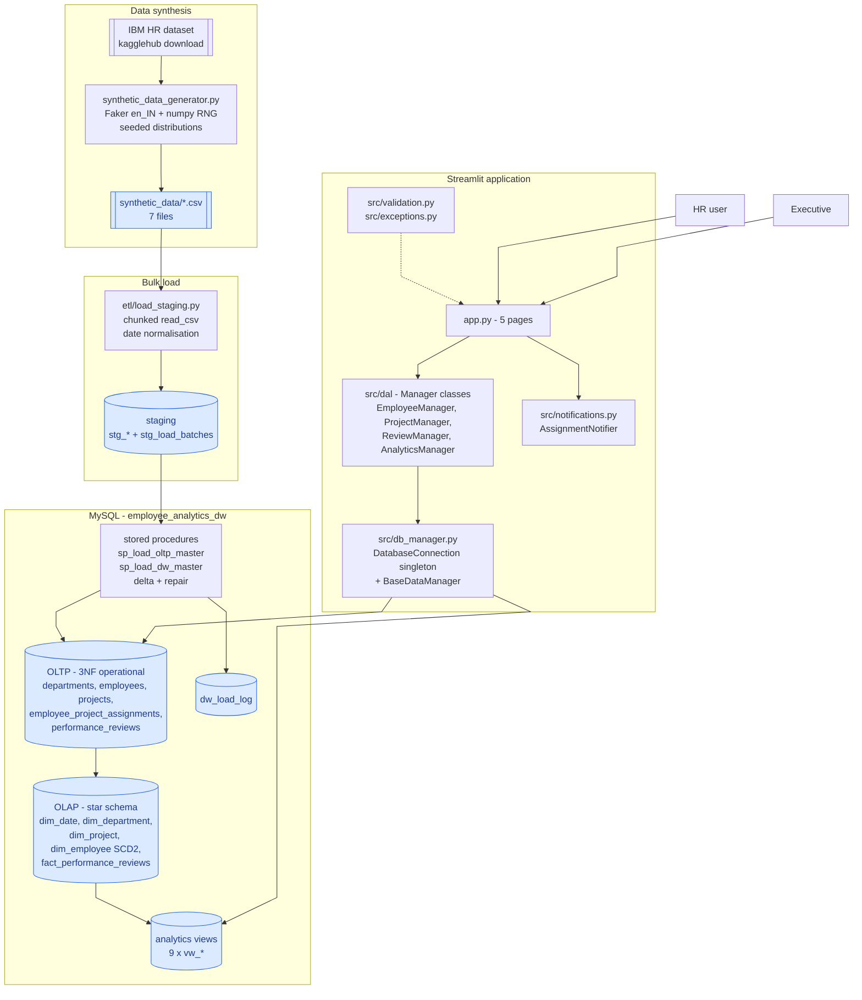
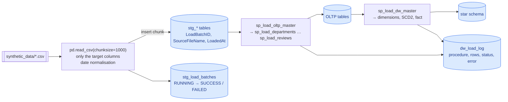
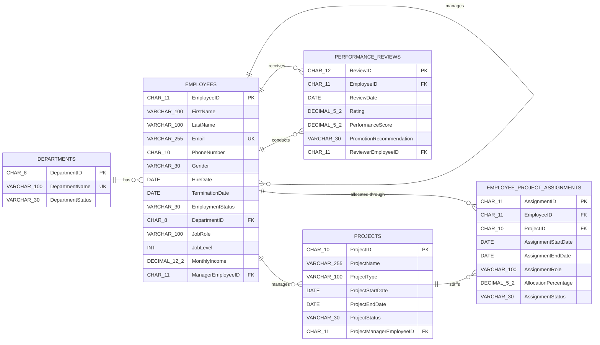
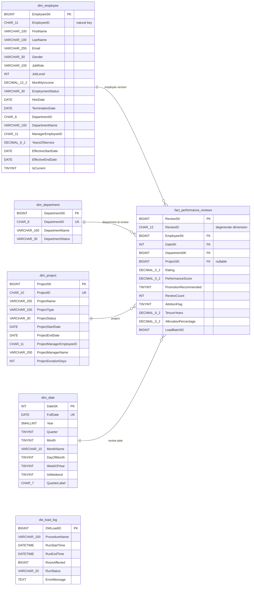
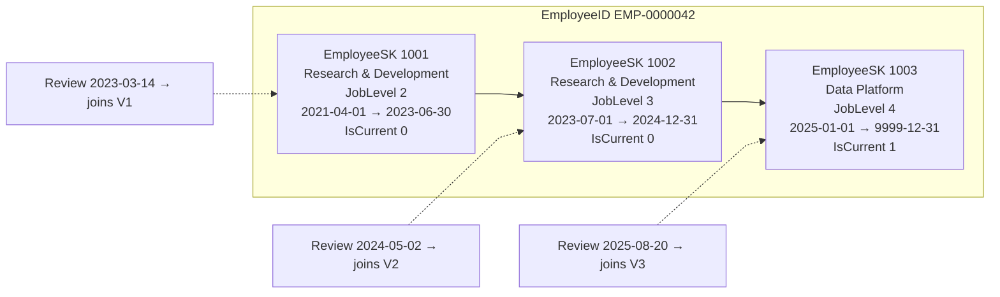
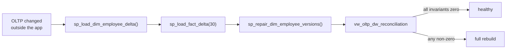
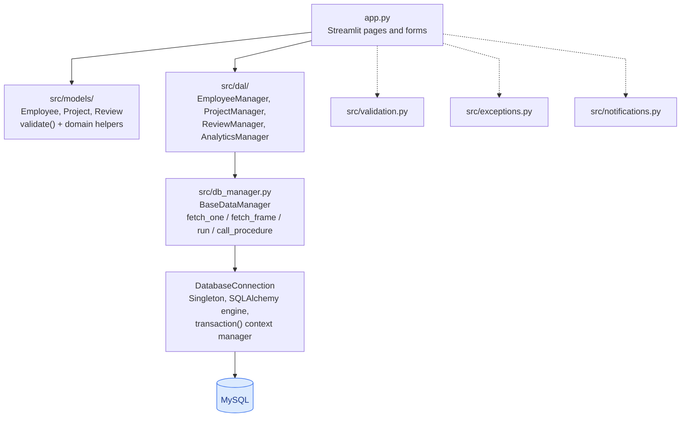

# ⚡ SkillFlow — Enterprise Workforce Intelligence & Data Warehouse

[](https://github.com/PratikModi22/SkillFlow)
[](https://www.python.org/)
[](https://www.mysql.com/)
[](https://streamlit.io/)
[](https://github.com/PratikModi22/SkillFlow)
[](https://github.com/PratikModi22/SkillFlow)

**SkillFlow** is a comprehensive, production-grade enterprise workforce intelligence platform built on a three-tier MySQL Data Warehouse architecture. It unifies high-throughput transactional HR operations (OLTP) with analytical business intelligence (OLAP) using a Kimball Star Schema with **Slowly Changing Dimensions (SCD Type 2)**.

Featuring an advanced **Role-Based Access Control (RBAC)** security model and a modern Streamlit & Plotly executive control center, SkillFlow guarantees real-time operational writeback, point-in-time historical tracking, and predictive attrition modeling.

**Author & Maintainer:** [Pratik Modi](https://github.com/PratikModi22)  
**Repository:** [https://github.com/PratikModi22/SkillFlow](https://github.com/PratikModi22/SkillFlow)

| Attribute | Specification |
|---|---|
| **Source Data** | 110k+ synthetic HR rows generated from real-world IBM HR benchmark distributions |
| **Warehouse** | 4 conformed dimensions, 1 fact table, 9 analytical views, 20 stored procedures |
| **Grain** | One row per performance review (Point-in-time snapshot) |
| **History** | Every employee career transition tracked as a versioned `dim_employee` row (SCD Type 2) |
| **Security** | Role-Based Access Control (RBAC) with 4 permission tiers (Admin, Manager, Auditor, Employee) |
| **Front End** | Modern Streamlit + Plotly interactive dashboard with reactive state management |
| **Stack** | MySQL 8.0, Python 3.11+, Pandas, NumPy, SQLAlchemy, PyMySQL, Plotly, python-dotenv |

---

## Contents

1. [What the system does](#1-what-the-system-does)
2. [Architecture](#2-architecture)
3. [Repository layout](#3-repository-layout)
4. [Data synthesis](#4-data-synthesis)
5. [Bulk loading and the staging layer](#5-bulk-loading-and-the-staging-layer)
6. [OLTP model](#6-oltp-model)
7. [OLAP star schema](#7-olap-star-schema)
8. [Slowly Changing Dimension Type 2](#8-slowly-changing-dimension-type-2)
9. [Stored procedure catalogue](#9-stored-procedure-catalogue)
10. [Analytics views](#10-analytics-views)
11. [Incremental loading and reconciliation](#11-incremental-loading-and-reconciliation)
12. [Python application architecture](#12-python-application-architecture)
13. [Streamlit application & RBAC security](#13-streamlit-application)
14. [Technology stack](#14-technology-stack)
15. [Setup](#15-setup)
16. [Pipeline reference](#16-pipeline-reference)
17. [Configuration reference](#17-configuration-reference)
18. [Design decisions and limitations](#18-design-decisions-and-limitations)

---

## 1. What the system does

The pipeline answers one question end to end: **what did the organisation look
like at any point in time?**

That question is why the employee dimension is versioned. A review recorded before
a promotion must still be attributed to the department the person was in *on the
day of the review*, not the department they hold today. Every other layer exists to
make that possible:

- **Synthesis** — 15,000 employees, 19,948 effective-dated employee versions,
  1,500 projects, 36,007 allocations and 38,814 performance reviews are generated
  deterministically, with the distributions and categorical values seeded from the
  public IBM HR Analytics dataset.
- **Staging** — CSVs land verbatim, in 1,000-row chunks, with a batch id stamped
  on every row so any load can be traced and re-run.
- **Normalisation** — staging is projected into a 3NF OLTP schema with foreign
  keys, `CHECK` constraints and unique business rules.
- **Analytics** — the OLTP tables are projected into a star schema: conformed
  dimensions, surrogate keys, a degenerate `ReviewID` on the fact table, and a
  full employee version history.
- **Consumption** — nine views package the analytics; a Streamlit app renders them
  and lets an HR user onboard an employee, move them between departments, create
  projects and submit reviews.

The interesting part is that the app is a *writer* as well as a reader. When an HR
user transfers an employee, the OLTP row is updated **and** a new `dim_employee`
version is written, in the same database transaction. The warehouse cannot fall
behind a change made anywhere in the application.

---

## 2. Architecture



**Key design decision: the app never runs ETL.** It writes to OLTP through the
managers and reads analytics from OLAP through the views. Reloading the warehouse
stays an explicit, auditable operation — run from the CLI, or on demand from the
app's *Sync & health* tab.

**Second decision: the two systems are kept honest by a view.**
`vw_oltp_dw_reconciliation` compares the OLTP and the warehouse directly and is
read by the pipeline, by the app, and by anyone with a MySQL client. A broken
invariant is therefore visible before it becomes a wrong chart.

---

## 3. Repository layout

```
.
├── app.py                        Streamlit UI - 5 pages, 1,800+ lines
├── requirements.txt              pinned dependencies
├── synthetic_data_generator.py   IBM-seeded synthetic data generator
├── .env                          local secrets - never commit
├── .streamlit/secrets.toml       Streamlit secrets - never commit
│
├── database/                     ordered, numbered, re-runnable DDL + ETL
│   ├── 01_create_database.sql              CREATE / DROP DATABASE
│   ├── 02_create_staging.sql               stg_* landing tables
│   ├── 03_create_oltp.sql                  3NF operational schema
│   ├── 04_create_dw.sql                    star schema + dim_date + dw_load_log
│   ├── 05_etl_staging_to_oltp.sql          staging → OLTP procedures
│   ├── 06_etl_oltp_to_dw.sql               OLTP → OLAP procedures, SCD2
│   ├── 07_dashboard_queries.sql            7 analytics views
│   ├── 08_create_indexes.sql               guarded OLAP index tuning
│   ├── 09_alter_fixed_length_columns.sql   backward-compatible CHAR migration
│   └── 10_incremental_loads.sql            delta loaders, repair, reconciliation
│
├── etl/
│   ├── run_pipeline.py              one-command build: DDL + staging + CALLs + checks
│   └── load_staging.py              CSV → staging chunked bulk loader
│
├── src/
│   ├── __init__.py                  package docstring + public re-exports
│   ├── db_manager.py                DatabaseConnection (singleton), BaseDataManager
│   ├── exceptions.py                typed error hierarchy
│   ├── validation.py                reusable field validators + FormValidator
│   ├── notifications.py             AssignmentNotifier - SMTP mail for allocations
│   ├── models/                      Employee, Project, Review entities
│   └── dal/                         EmployeeManager, ProjectManager,
│                                    ReviewManager, AnalyticsManager
│
└── synthetic_data/                 generated output - gitignored
    ├── departments.csv
    ├── employees.csv
    ├── employee_history.csv
    ├── projects.csv
    ├── employee_project_assignments.csv
    ├── performance_reviews.csv
    └── synthetic_data_dictionary.csv
```

---

## 4. Data synthesis

`synthetic_data_generator.py` is a standalone script. The database pipeline never
invokes it, so it is a deliberate pre-step: generate once, then load.

```bash
python synthetic_data_generator.py
```

### How the data is produced

| Stage | What happens |
|---|---|
| Seed | The IBM HR Analytics dataset is downloaded with `kagglehub.dataset_download` and validated for the nine columns the generator actually uses: `Department`, `JobRole`, `JobLevel`, `MonthlyIncome`, `Attrition`, `Gender`, `MaritalStatus`, `EducationField`, `PerformanceRating`. |
| Determinism | One `numpy.random.default_rng(random_seed)` and one `Faker("en_IN")` instance drive everything, so the same seed reproduces the same 110k rows. Names, phone numbers and emails are Indian-locale, matching the INR formatting in the UI. |
| Scaling | The IBM sample is expanded to 15,000 employees. Categorical values are resampled from the IBM empirical distribution rather than invented, so job roles, salary bands and attrition behaviour stay plausible. |
| History | 35% of employees are given 2–4 effective-dated versions (promotion, transfer, pay rise), each with a start date, an end date, an `IsCurrent` flag and a `ChangeReason`. Employees without generated history still get one version derived from the hire date, so `dim_employee` is complete either way. |
| Attrition | Termination is drawn from a probability that rises with low `PerformanceRating`, low `JobSatisfaction` and long tenure, and a termination date is stamped only when one is drawn. |
| Projects | 1,500 projects with typed names and durations; each employee receives 1–5 allocations at 10–100% with a role and a start date. |
| Reviews | Each employee receives 2–5 reviews between hire and the reference date, with a rating, a 0–100 score and a rule-based promotion recommendation. |
| Dictionary | `synthetic_data_dictionary.csv` is written last: one row per file/column with its dtype and nullability, so the CSV contract is documented by the generator that owns it. |

### Output volumes

| File | Rows | Grain |
|---|---:|---|
| `departments.csv` | 12 | one department |
| `employees.csv` | 15,000 | current employee snapshot |
| `employee_history.csv` | 19,948 | one employee version |
| `projects.csv` | 1,500 | one project |
| `employee_project_assignments.csv` | 36,007 | one allocation period |
| `performance_reviews.csv` | 38,814 | one review event |
| **Total** | **110,281** | |

### Configuration

All settings live in the frozen `GeneratorConfig` dataclass at the top of the
script, and the `__main__` block builds one explicitly:

| Setting | Default | Effect |
|---|---|---|
| `random_seed` | `42` | Reproduces the whole dataset |
| `num_employees` | `15_000` | Size of the employee population |
| `historical_employee_percentage` | `0.35` | Share of employees given SCD2 history |
| `min_history_versions` / `max_history_versions` | `2` / `4` | Versions per historical employee |
| `num_projects` | `1_500` | Project count |
| `min_projects_per_employee` / `max_...` | `1` / `5` | Allocations per employee |
| `min_reviews_per_employee` / `max_...` | `2` / `5` | Reviews per employee |
| `organization_start_date` | `2022-01-01` | Earliest project start |
| `reference_date` | `2026-10-01` | "Today" for generated activity |
| `ibm_dataset` | `pavansubhasht/ibm-hr-analytics-attrition-dataset` | Kaggle slug |

---

## 5. Bulk loading and the staging layer

Running the `.sql` files only *defines* tables and procedures. Loading is a
separate, explicit concern, and it starts with landing the CSVs untouched.



### The landing contract

Every staging row carries three audit columns — `LoadBatchID`, `SourceFileName`
and `LoadedAt` — and `stg_load_batches` records the start time, end time, status
and error text for the run. The batch id is not decoration: it is what makes a
load re-runnable and a bad batch identifiable without guessing.

Staging tables hold no keys, no defaults and no constraints beyond the CSV
contract. Normalisation is deliberately left to the procedures, so the landing
zone can absorb a malformed value that the target schema would reject.

### Why staging keeps its history

`stg_employee_history` carries the full effective-dated employment history from
the generator. That is what makes SCD2 *reconstructable* rather than invented:
dimension versions come from real source periods rather than from whatever
happened to change during the load. `sp_load_dim_employee_full()` replays those
periods, so a full rebuild reproduces the same 19,948 versions the incremental
path would have produced.

### `etl/load_staging.py`

| Behaviour | Detail |
|---|---|
| Chunking | `pd.read_csv(..., chunksize=1000)` and one `executemany` per chunk, so peak memory stays flat regardless of file size |
| Projection | Only the columns the target table declares are inserted; extra CSV columns are ignored and missing ones fail loudly |
| Dates | Mixed formats (`dd-mm-yyyy`, `yyyy-mm-dd`, pandas timestamps) are normalised before insert, so the DATE columns never receive a string |
| Types | Nullable numerics are coerced; empty strings become `NULL` rather than `''` |
| Batch handling | A batch row is opened before the first chunk and closed with row counts and status afterwards; a failure records the error text and stops the run |
| Configuration | `DATABASE_URL` for the connection, `SYNTHETIC_DATA_DIR` for the CSV folder |

---

## 6. OLTP model

Normalised, 3NF, with business keys as `CHAR` columns so an index comparison is
a byte comparison and a join cannot fall back to a conversion that disables the
index.



### Business keys

| Entity | Format | Width |
|---|---|---|
| Department | `DEPT-001` | `CHAR(8)` |
| Employee | `EMP-0000001` | `CHAR(11)` |
| Project | `PROJ-00001` | `CHAR(10)` |
| Assignment | `ASG-0000001` | `CHAR(11)` |
| Review | `REV-0000001` | `CHAR(12)` |

The generator, the schema and the UI all use the same formats. `src/validation.py`
enforces them with `validate_identifier`, so a mistyped id is rejected in the form
rather than truncated by the column.

### Rules enforced by the schema and the DAL

| Rule | Enforced by |
|---|---|
| Email is unique across employees | `uq_employees_email` + `EmployeeManager.add_employee` |
| Department name is unique | `uq_departments_name` |
| One review per employee per day | `uq_reviews_emp_date` |
| One allocation per employee/project/start date | `uq_assignments_emp_proj` |
| Allocation is within 1–100% | `chk_assignments_allocation` + `validate_number` |
| An employee's *total* active allocation cannot exceed 100% | `ProjectManager.add_assignment` — sums the open allocations before inserting |
| Rating is 1–5, score is 0–100 | `chk_reviews_rating`, `chk_reviews_score` |
| A project with assignments cannot be deleted | `ProjectManager.delete_project` |
| A phone number is exactly 10 digits | `validate_phone` — `CHAR(10)` would silently space-pad a shorter value and then fail to match on lookup |

---

## 7. OLAP star schema



### Grain and measures

The fact grain is **exactly one performance review**. `ReviewID` stays on the fact
table as a degenerate dimension, and `ReviewCount` is a constant 1 so that
`COUNT(*)` and `SUM(ReviewCount)` agree.

| Measure | Type | Additive |
|---|---|---|
| `Rating` | `DECIMAL(5,2)` | semi-additive |
| `PerformanceScore` | `DECIMAL(5,2)` | semi-additive |
| `PromotionRecommended` | `TINYINT` | semi-additive |
| `ReviewCount` | `INT` | additive |
| `AttritionFlag` | `TINYINT` | snapshot at review time |
| `TenureYears` | `DECIMAL(6,2)` | snapshot at review time |
| `AllocationPercentage` | `DECIMAL(5,2)` | snapshot at review time |

The last three are **review-time snapshots**, not current-state values. They are
captured when the fact row is written so attrition analytics do not have to join
back to a dimension that has since moved on.

`ProjectSK` is nullable because a review may not be tied to a project. Every other
foreign key is enforced, and all four are covered by composite indexes sized for
the point-in-time join.

### Surrogate keys

Every dimension has a surrogate key (`*SK`) that the fact table points at, plus a
unique natural key (`*ID`). `dim_employee` is the exception that proves the rule:
its natural key is *not* unique, because an employee has many versions. The
unique constraint there is `(EmployeeID, EffectiveStartDate)`.

`dim_date` is populated by a recursive CTE covering 2018-01-01 to 2026-12-31
(3,287 rows). `DateSK` is the integer `YYYYMMDD`, so the key is human-readable and
sorts naturally. The insert only fills gaps, so re-running the script is safe.

---

## 8. Slowly Changing Dimension Type 2

Each `dim_employee` row is a *version*, not a person.



### Semantics

| Column | Meaning |
|---|---|
| `EmployeeSK` | Surrogate key; the fact table's only reference to the employee |
| `EmployeeID` | Natural key, stable across versions |
| `EffectiveStartDate` | First day this version is valid |
| `EffectiveEndDate` | Last day valid; `'9999-12-31'` while the version is open |
| `IsCurrent` | `1` for the open version, `0` otherwise |
| `YearsOfService` | Computed to the end of the validity window, identically in the full and incremental paths |

Tracked attributes: `DepartmentID` / `DepartmentName`, `JobRole`, `JobLevel`,
`MonthlyIncome`, `EmploymentStatus`, `HireDate`, `TerminationDate`,
`ManagerEmployeeID`.

### The invariants

| Invariant | Enforced by |
|---|---|
| Exactly one open version per `EmployeeID` | `sp_repair_dim_employee_versions()`, run at the end of every master load and every sync |
| No version starts before the newest stored version | `sp_apply_employee_change` refuses with `SIGNAL SQLSTATE '45000'` |
| No two versions share a start date | Unique key `(EmployeeID, EffectiveStartDate)`; a change dated on the newest version rewrites it in place |
| `EffectiveEndDate >= EffectiveStartDate` | `chk_dim_employee_version` |
| Every employee in the OLTP has a version | `vw_oltp_dw_reconciliation.employees_missing_from_dim` |
| A terminated employee's last version closes on the termination date | `sp_load_dim_employee_full()` and `sp_apply_employee_change()` compute the same window |

### `sp_apply_employee_change(p_EmployeeID, p_ChangeDate, p_Force)`

The single entry point for versioning a change. Onboarding, the department-change
screen and the delta loader all call it, so no code path can write an employee
change without telling the dimension.

| Situation | Behaviour |
|---|---|
| Employee has no version yet | First version starts on the hire date. Never skipped. |
| Nothing tracked actually changed | No version written. The comparison uses `<=>`, so a `NULL` does not read as a change. |
| Change dated after the newest version | Old version closed the day before, new one inserted |
| Change dated *on* the newest version | That version is rewritten in place, so two versions can never share a start date |
| Employee has been terminated | New version closes on the termination date rather than staying open, which is exactly what a full rebuild produces |
| Change dated before the newest version | Refused with `SIGNAL SQLSTATE '45000'`; the app shows the reason |
| Employee or department does not exist | Refused *before* the current version is closed, rather than writing nothing and reporting success |
| `p_Force = 1` | Version unconditionally, for a deliberate correction |

The refusals are the feature. The failure mode this procedure replaced was a
silent one: an OLTP row changed while the warehouse kept serving the old
department for ever.

### Point-in-time fact loading

`sp_load_fact_performance_reviews()` does not join the employee dimension on
`IsCurrent = 1`. It resolves the version that was valid **on the review date**:

```sql
SELECT d.EmployeeSK, d.DepartmentSK
FROM dim_employee d
WHERE d.EmployeeID = r.EmployeeID
  AND d.EffectiveStartDate <= r.ReviewDate
  AND (d.EffectiveEndDate >= r.ReviewDate OR d.IsCurrent = 1)
```

That single predicate is what makes a review recorded in March still report the
department the person worked in that March. If two versions ever overlapped, the
join would return two rows and the fact count would rise above the review count —
which is why `reviews_outside_calendar` and the duplicate-version invariant are
checked explicitly rather than assumed.

---

## 9. Stored procedure catalogue

### Staging → OLTP (`05_etl_staging_to_oltp.sql`)

| Procedure | Responsibility |
|---|---|
| `sp_load_departments()` | Load and upsert departments |
| `sp_load_employees()` | Load and upsert the employee snapshot |
| `sp_load_projects()` | Load and upsert projects |
| `sp_load_assignments()` | Load and upsert allocations |
| `sp_load_reviews()` | Load and upsert performance reviews |
| `sp_load_oltp_master()` | Runs all five in dependency order and logs to `dw_load_log` |

### OLTP → OLAP (`06_etl_oltp_to_dw.sql`)

| Procedure | Responsibility |
|---|---|
| `sp_load_dim_department()` | Upsert the conformed department dimension (SCD1) |
| `sp_load_dim_project()` | Upsert the project dimension, denormalising the manager name and project duration |
| `sp_load_dim_employee_full()` | Replay `stg_employee_history` into versioned `dim_employee` rows, seeding a version for employees who have no history |
| `sp_apply_employee_change()` | Version one employee's change (see [section 8](#8-slowly-changing-dimension-type-2)) |
| `sp_repair_dim_employee_versions()` | Re-establish "exactly one open version, and it is the newest" |
| `sp_load_fact_performance_reviews()` | Rebuild the fact table with point-in-time surrogate key resolution |
| `sp_load_dw_master()` | Runs the dimensions, then the fact load, then the repair; returns a summary row |

### Incremental and maintenance (`10_incremental_loads.sql`)

| Procedure | Responsibility |
|---|---|
| `sp_load_dim_employee_delta()` | Seed employees with no version, and version only those whose tracked attributes moved |
| `sp_load_fact_delta(p_LookbackDays)` | Rebuild reviews dated within the lookback window (default 30, clamped to 0–3650) |
| `sp_reconcile_dw(p_LookbackDays)` | Runs the two deltas then the repair, and returns the reconciliation row |

### Schema helpers

| Procedure | File | Responsibility |
|---|---|---|
| `sp_add_index_if_missing()` / `sp_drop_index_if_present()` | `08` | Idempotent index creation, so tuning can be re-run safely |
| `sp_drop_fk_if_exists()` / `sp_check_fixed_width_fits()` | `09` | Drop and verify constraints before converting `VARCHAR` keys to `CHAR`; cleaned up at the end of the script |

`09_alter_fixed_length_columns.sql` exists for databases built before the
`CHAR` change. A database created with `--reset` already has `CHAR` columns, so
the script is a no-op there; the pipeline runs it anyway because a converted
column invalidates index statistics, and it must therefore run *before* the
`ANALYZE TABLE` in step 8.

---

## 10. Analytics views

Every dashboard query reads a view. No page scans a fact table directly.

| View | Answers | Technique |
|---|---|---|
| `vw_kpi_summary` | Headcount, attrition %, average salary, average tenure, average score | Current versions only |
| `vw_performance_trend_yoy` | Year-over-year score movement | `LAG()` over year |
| `vw_top_performers_by_department` | Best performers within each department | `DENSE_RANK()` partitioned by department |
| `vw_attrition_risk` | Weighted risk score and band per employee | Score, rating, tenure and status combined |
| `vw_project_bottlenecks` | Allocation load, score gap vs company average, status | Running `AVG() OVER` |
| `vw_department_headcount_history` | Headcount replayed year by year | SCD2 windows replayed per snapshot year |
| `vw_pay_progression` | Per-employee salary and department movement | `LAG()` on version start dates |
| `vw_dim_employee_drift` | Which employees the warehouse has not caught up with | OLTP vs latest version comparison |
| `vw_oltp_dw_reconciliation` | Every way the OLTP and the warehouse can disagree, as one row | Left joins between the two systems |

### Why the drift view excludes generated history

`vw_dim_employee_drift` deliberately covers only employees **without** a staging
history. The generated history runs forward from the IBM snapshot, so for 4,761 of
the 15,000 imported employees the newest history version legitimately describes a
promotion that was never written back to the `employees` table. Comparing those
against the OLTP row would report 4,761 phantom changes and version a third of the
workforce on every sync.

History is the source of truth for those versions, so the count is published as
`employees_history_newer_than_oltp` — visible, explained, and not treated as a
defect.

---

## 11. Incremental loading and reconciliation

A full rebuild is the recovery tool, not the everyday one.



```sql
CALL sp_load_dim_employee_delta();   -- seed employees with no version,
                                     -- version the ones whose attributes moved
CALL sp_load_fact_delta(30);         -- refresh reviews inside the lookback window
CALL sp_repair_dim_employee_versions();
```

`sp_reconcile_dw(30)` runs all three in that order. The *Sync & health* tab in the
app runs exactly the same sequence through `AnalyticsManager.sync_warehouse()`.

The fact lookback exists because a transfer can be back-dated: a review older than
the window can still be re-pointed at a different employee version, but rebuilding
every review on every sync is not worth it. The default 30-day window is the
trade-off, and it is adjustable per run.

### The invariants

`vw_oltp_dw_reconciliation` returns these as one row. `run_pipeline.py` fails the
build if any is non-zero; the app shows them as a pass/fail table.

| Invariant | Non-zero means |
|---|---|
| `employees_missing_from_dim` | An OLTP employee has no `dim_employee` version |
| `dim_rows_without_employee` | A dimension version has no OLTP employee |
| `reviews_missing_from_fact` | An OLTP review never reached the fact table |
| `facts_without_review` | A fact row has no OLTP review |
| `reviews_outside_calendar` | A review date is outside the `dim_date` range |
| `employees_with_two_open_versions` | The point-in-time join is ambiguous |
| `stale_open_versions` | An open version is not the newest version |

`drifted_employees` is reported but is deliberately **not** a failure: a non-zero
value means someone edited an app-created employee in the OLTP without publishing
it yet. That is a state to report, not a broken build.

### Idempotency

Running the pipeline twice does not duplicate rows, and it does not discard work
done through the app:

- `dim_employee`, `dim_department` and `dim_project` are **upserted**, never
  truncated, so a version written by a transfer survives a full refresh and is
  closed correctly rather than overwritten.
- Rows the app created that staging has never seen are reloaded from the OLTP
  tables by the delta loaders.
- `sp_load_dw_master()` truncates and rebuilds the fact table, which is safe
  because a fact row is a pure function of the OLTP review.
- Every DDL statement in `08` is guarded, so index tuning is re-runnable.

`run_pipeline.py` proves this rather than asserting it: `APP_EXTRA_SQL` counts the
rows that exist only because the app created them, and the expected count is the
staging baseline *plus* exactly those rows. Accepting `>= expected` would hide a
partial load.

---

## 12. Python application architecture

Four layers, each with one job. Dependencies point downwards only.



### `DatabaseConnection` and `BaseDataManager`

`DatabaseConnection` is a singleton wrapping a SQLAlchemy engine. One reason: a
Streamlit script re-runs on every interaction, and without it each rerun would
build a new engine and exhaust the connection pool. It exposes
`query_frame()`, `query_row()`, `execute()` and a `transaction()` context manager.

`BaseDataManager` is the base for every manager. It centralises parameter binding,
logging, error translation and the four access primitives
(`fetch_one`, `fetch_frame`, `fetch_value`, `run`, `call_procedure`) so a manager
method reads as SQL plus intent, with no boilerplate.

### Managers

| Manager | Writes | Reads |
|---|---|---|
| `EmployeeManager` | `add_employee`, `update_employee`, `change_department`, `delete_employee` | Directory, department list, job-role and manager pickers, SCD2 timeline, dependency counts |
| `ProjectManager` | `add_project`, `update_project_status`, `delete_project`, `add_assignment`, `end_assignment` | Project list, assignments, allocation totals |
| `ReviewManager` | `add_review`, `delete_review` | Review list, per-employee history |
| `AnalyticsManager` | `sync_warehouse`, `run_full_refresh` | Everything in the nine views, plus the load log and reconciliation |

### The OLTP-to-warehouse bridge

`EmployeeManager` writes to `employees` **and** calls
`sp_apply_employee_change` inside the same transaction:

```python
with self.db.transaction() as conn:
    conn.execute(text(sql), params)
    conn.execute(text("CALL sp_apply_employee_change(:employee_id, :change_date, :force)"),
                 {"employee_id": ..., "change_date": ..., "force": 0})
```

Consequences worth stating plainly:

- An employee cannot exist in the OLTP without existing in the warehouse. The
  procedure refuses to complete without writing a version, and the manager
  additionally verifies the open-version count is exactly 1 before returning —
  rolling the transaction back otherwise.
- A `SIGNAL` raised inside the procedure arrives as a raw `SQLAlchemyError`,
  because `transaction()` does not wrap it. `translate_db_error()` converts it
  into the typed error the UI knows how to render.
- A second edit on the same day rewrites that day's version instead of stacking
  two versions with the same start date, which is why a same-day correction is
  recognisable as a correction rather than a second event.

### Models

`Employee`, `Project` and `Review` are plain dataclasses with `from_row()`,
`to_dict()`, `validate()` and a `__str__`. Business rules live in the model, not in
the form: `Review.suggest_promotion()` returns true for rating ≥ 4 **and** score
≥ 75, `quality_band()` classifies a score, and `Employee.validate()` rejects a job
level outside 1–10 or negative income. `validate()` runs before every write, so an
invalid entity never reaches SQL.

### Validation

`src/validation.py` mirrors the OLTP column widths exactly, so a value that passes
validation is a value the database can store. The sharpest case is
`PhoneNumber`: it is `CHAR(10)`, so a nine-digit number would not be rejected —
it would be space-padded and then silently fail to match on a later lookup. The
validator therefore demands exactly 10 digits in the Indian mobile range.

`FormValidator` collects every failure in one pass, so a form can say "these three
fields are wrong" instead of making the user submit repeatedly to discover each
problem in turn.

In the UI, `guarded_input()` sanitises a field's session state in an `on_change`
callback: a disallowed character is stripped before the widget redraws, which
makes the key press look as though it never registered. Validation runs on commit
(Enter or focus loss), which is also when the inline error appears.

### Exceptions

`AppError` is the root. Below it: `DatabaseError` → `ConnectionFailedError`,
`QueryError`, `DataAccessError`; and `ValidationError`, `NotFoundError`,
`DuplicateRecordError`, `DataWarehouseError`. Each carries a message written for
the person using the app, so the UI can render `str(exc)` directly.

---

## 13. Streamlit application

`app.py` is a single-file Streamlit app with a sidebar radio navigation and five
pages. Managers are created once per session with `@st.cache_resource`, and the
sidebar shows connection status from a live `SELECT 1`.

| Page | Tabs | What it does |
|---|---|---|
| **Dashboard** | — | KPI cards, year-over-year performance trend, top performers by department, attrition risk, project bottleneck analysis |
| **Employees** | Directory · Onboard employee · Change department (SCD2) | Searchable directory with department and status filters; onboarding form; the transfer screen that writes a new dimension version |
| **Projects** | Project list · Create project · Assign employee | Filtered project table with assignment counts; project creation; allocation with a live 100%-cap check and an email notification |
| **Reviews** | Submit review · Review history | Review submission with a rule-based promotion suggestion and a quality band; history with score trend |
| **Warehouse** | SCD2 explorer · Warehouse contents · ETL load log · Sync & health | Version timeline per employee; row counts per table; headcount history replayed from SCD2; the load log; reconciliation plus the on-demand sync |

### Screens worth describing

**Department change (SCD2).** The end-to-end demonstration of the requirement. One
button updates the OLTP row and writes a new `dim_employee` version in the same
action, and the version timeline refreshes immediately. The same procedure serves
onboarding, so the warehouse cannot fall behind a change made anywhere in the app.

**SCD2 explorer.** Pick an employee, see every version with its validity window
and the reason it changed, and read which reviews joined which version. This is
where the point-in-time join becomes visible rather than theoretical.

**Sync & health.** Shows `vw_oltp_dw_reconciliation` as a pass/fail table with the
invariant list, the count of unpublished changes, and a lookback window. Pressing
*Sync warehouse* runs the delta loaders and then redraws the panel from the
post-sync reconciliation, so the invariants flip to "ok" without a page refresh.
Drift from generated history is shown as a caption with an explanation, not as a
failure.

**Assignment notification.** Creating an allocation emails the assigned employee.
The write is committed first; the mail is attempted second and can never raise.
See [section 17](#17-configuration-reference).

### Role-Based Access Control (RBAC)

SkillFlow implements a multi-tier Role-Based Access Control (RBAC) security architecture defined in `src/rbac.py`. The system features dynamic navigation filtering and application-level write guards across four distinct operational roles:

| Role | Access Scope & Navigation | Write Capabilities |
|---|---|---|
| **👑 HR Administrator** | Full access to all 5 sections (`Dashboard`, `Employees`, `Projects`, `Reviews`, `Warehouse`). | **Full Read & Write**: Onboard employees, execute SCD2 transfers, create projects, assign staff, submit reviews, and trigger warehouse delta sync. |
| **👥 Department Manager** | Access to `Dashboard`, `Employees`, `Projects`, and `Reviews`. Hidden: `Warehouse`. | **Operational Write**: Transfer employees (SCD2), assign project personnel, and submit appraisals. Restricted from ETL sync. |
| **📊 Data Analyst / Auditor** | Full read-only visibility across `Dashboard`, `Employees`, `Projects`, `Reviews`, and `Warehouse`. | **Strict Read-Only**: Can audit historical records, logs, and metrics. All OLTP write mutations are disabled with access warning cards. |
| **👤 Standard Employee** | Minimal self-service view: `Employees` (directory) and `Projects` (team rosters). | **Read-Only Self-Service**: Executive attrition modeling and warehouse internals are protected. |

The sidebar includes an active **Security Role Switcher** and profile badge, allowing evaluators and stakeholders to seamlessly test permission boundaries live.

---

## 14. Technology stack

| Layer | Technology | Version | Role |
|---|---|---|---|
| Database | MySQL | 8.x | OLTP + OLAP in one schema, InnoDB, `CHECK` constraints, recursive CTEs, window functions |
| Driver | PyMySQL | 1.2.3 | Used by the ETL scripts |
| ORM / engine | SQLAlchemy | 2.1.2 | Engine pooling, parameter binding, transactions |
| Data synthesis | pandas / NumPy / Faker | 2.2.3 / 2.4.6 / 37.6.0 | Chunked CSV I/O, seeded RNG, synthetic people |
| Dataset source | kagglehub | 1.0.2 | Downloads the IBM HR dataset |
| Web | Streamlit | 1.64.0 | Five-page application |
| Charts | Plotly | 7.1.0 | All visualisations |
| Config | python-dotenv | 1.2.4 | Loads `.env` locally |

MySQL 8 is required, not optional: the schema uses enforced `CHECK` constraints,
recursive CTEs for the calendar, window functions (`ROW_NUMBER`, `DENSE_RANK`,
`LAG`, `SUM ... OVER`, `AVG ... OVER`) and `SIGNAL SQLSTATE` for procedural error
handling.

---

## 15. Setup

### Prerequisites

- MySQL 8.x running locally
- Python 3.11+
- A MySQL account that can `CREATE DATABASE`

### 1. Clone and create an environment

```bash
git clone https://github.com/PratikModi22/SkillFlow.git
cd SkillFlow

python -m venv env
.\env\Scripts\Activate.ps1        # Windows PowerShell
# source env/bin/activate         # macOS / Linux
```

### 2. Install dependencies

```bash
pip install -r requirements.txt
```

### 3. Configure the connection

Create `.env` in the repository root:

```dotenv
DATABASE_URL=mysql+pymysql://DB_USER:DB_PASSWORD@DB_HOST:3306/employee_analytics_dw
```

For Streamlit Cloud, or to keep credentials out of the environment, also create
`.streamlit/secrets.toml`:

```toml
DATABASE_URL = "mysql+pymysql://DB_USER:DB_PASSWORD@DB_HOST:3306/employee_analytics_dw"
```

Both files are gitignored. The value in `secrets.toml` must be a string.

### 4. Generate the source data

```bash
python synthetic_data_generator.py
```

This downloads the IBM dataset and writes the seven CSVs into `synthetic_data/`.
Run it once; the pipeline reads the files, it does not generate them.

### 5. Build the database

```bash
python etl/run_pipeline.py --reset
```

> `--reset` runs `database/01_create_database.sql`, which **drops the database**.
> Use it on a fresh clone. On a database that already holds data, run
> `python etl/run_pipeline.py` without it.

The pipeline prints a row-count table, then the reconciliation report, and exits
non-zero if any count or invariant is unexpected. A successful run ends with
`Next: streamlit run app.py`.

### 6. Launch the app

```bash
streamlit run app.py
```

### Everything in one block

```bash
git clone https://github.com/PratikModi22/SkillFlow.git && cd SkillFlow
python -m venv env && .\env\Scripts\Activate.ps1
pip install -r requirements.txt
python synthetic_data_generator.py
python etl/run_pipeline.py --reset
streamlit run app.py
```

---

## 16. Pipeline reference

`etl/run_pipeline.py` exists because running the `.sql` files is not enough: the
`CALL` statements in scripts 05 and 06 sit *inside* the procedure bodies, so
nothing moves from staging to OLTP — or from OLTP to OLAP — until the procedures
are invoked. It is very easy to run every script, watch staging fill up, and end
up with an empty warehouse.

| Flag | Effect |
|---|---|
| *(none)* | Runs scripts 02–07 and 10, loads staging only if empty, runs both masters, migrates keys, tunes indexes, verifies. Safe to repeat. |
| `--reset` | Runs `01_create_database.sql` first. **Drops the database.** |
| `--load` | Forces a fresh staging load without dropping the database. |
| `--no-indexes` | Skips `08_create_indexes.sql` and keeps the defaults from `04`. |

### What it does, in order

| Step | Action |
|---|---|
| Reset (optional) | `01_create_database.sql` — create the schema |
| 1 | `02` → `03` → `04` → `05` → `06` → `07` → `10`. DDL, procedures and views. `10` comes after `06` because `sp_load_dw_master()` calls the delta loaders it defines |
| 2 | `load_staging.py` if staging is empty (or `--load` / `--reset`) |
| 3 | `CALL sp_load_oltp_master()` then `CALL sp_load_dw_master()` — **the step that actually moves data** |
| 4 | `09_alter_fixed_length_columns.sql` — must precede the `ANALYZE`, because converting a column rewrites its indexes |
| 5 | `08_create_indexes.sql` — deliberately *after* the load, so indexes are built once over final data and the statistics are meaningful |
| — | Verification: row counts per layer, then `vw_oltp_dw_reconciliation` |

### Running the scripts by hand

If you prefer MySQL Workbench, the order matters and the two `CALL`s are the part
that is easy to forget:

| Order | Script | Note |
|---|---|---|
| 1 | `01_create_database.sql` | Drops and recreates the schema — once only |
| 2 | `02_create_staging.sql` | `stg_*` tables |
| 3 | `etl/load_staging.py` | Loads the CSVs |
| 4 | `03_create_oltp.sql` | Normalised OLTP tables |
| 5 | `04_create_dw.sql` | Dimensions, fact table, `dw_load_log`, calendar |
| 6 | `05_etl_staging_to_oltp.sql` | Defines `sp_load_oltp_master()` |
| 7 | `06_etl_oltp_to_dw.sql` | Defines `sp_load_dw_master()` and the SCD2 procedures |
| 8 | `07_dashboard_queries.sql` | The seven dashboard views |
| 9 | `10_incremental_loads.sql` | Delta loaders, repair, reconciliation views |
| 10 | `08_create_indexes.sql` | Index tuning, after the data is in |
| 11 | `CALL sp_load_oltp_master(); CALL sp_load_dw_master();` | **Without these, staging is full and the warehouse is empty** |

### Expected row counts

| Layer | Table | Rows |
|---|---|---:|
| Staging | `stg_departments` | 12 |
| Staging | `stg_employees` | 15,000 |
| Staging | `stg_employee_history` | 19,948 |
| Staging | `stg_projects` | 1,500 |
| Staging | `stg_employee_project_assignments` | 36,007 |
| Staging | `stg_performance_reviews` | 38,814 |
| OLAP | `dim_date` | 3,287 |
| OLAP | `dim_department` | 12 |
| OLAP | `dim_project` | 1,500 |
| OLAP | `dim_employee` | 19,948 |
| OLAP | `fact_performance_reviews` | 38,814 |

OLTP counts equal staging counts, plus whatever the application has added since.
`run_pipeline.py` computes that allowance instead of assuming it.

---

## 17. Configuration reference

### Connection

| Source | Precedence | Used by |
|---|---|---|
| `.streamlit/secrets.toml` → `DATABASE_URL` | 1st | `app.py` |
| Environment variable `DATABASE_URL` (from `.env`) | 2nd | `app.py`, `etl/*` |
| Local development default | 3rd | `app.py` |

`etl/load_staging.py` additionally honours `SYNTHETIC_DATA_DIR` to point at a CSV
folder other than `synthetic_data/`. `etl/run_pipeline.py` reads the CSV folder
relative to the repository root and does not use that variable.

All ten `.sql` files begin with `USE employee_analytics_dw`, so the schema name is
fixed by the scripts; `DATABASE_URL` supplies only host, port and credentials.

### Assignment notification emails

Creating an allocation emails the assigned employee. The receiver is always the
employee the project is allocated to, read from `employees.Email` and validated
before sending. The sender is configured in the environment.

| Variable | Purpose | Default |
|---|---|---|
| `MAIL_SENDER` | From address (**required**) | — |
| `MAIL_SENDER_NAME` | Display name shown next to it | `MAIL_SENDER` |
| `SMTP_HOST` | SMTP server (**required**) | `localhost` |
| `SMTP_PORT` | Submission port | `587` |
| `SMTP_USERNAME` / `SMTP_PASSWORD` | Login, when the server needs one | empty |
| `SMTP_USE_TLS` | `1` for STARTTLS, `0` for a plain relay | `1` |
| `SMTP_TIMEOUT` | Seconds to wait for the server | `10` |
| `MAIL_ENABLED` | `0` switches notifications off | `1` |

Locally these come from `.env`. On Streamlit Community Cloud there is no `.env`,
so the same names are read from `st.secrets` — identical variable names, no extra
configuration.

`AssignmentNotifier.notify_assignment()` never raises. It returns the outcome as
data, because the assignment is committed to OLTP **before** the mail is
attempted, so a delivery problem must never be reported as a failed booking:

| Outcome | What the UI shows |
|---|---|
| Address valid, server accepts it | "Email sent to …" |
| Address missing or invalid | The validation message; no SMTP attempt is made |
| `MAIL_SENDER` / `SMTP_HOST` unset, or `MAIL_ENABLED=0` | Informational: no mail sent |
| Server refused, timed out or rejected the login | Warning: the assignment was saved, the email was not sent |

`MailSettings.load()` takes a lookup function rather than reading `os.environ`
directly, which is what lets the Streamlit layer fall back to `st.secrets` with no
extra plumbing.

### Gitignored

`.env`, `.streamlit/secrets.toml`, `synthetic_data/`, `data/`, virtual environments,
`__pycache__/`. `.env` and the secrets file currently contain live credentials and
are tracked by neither Git nor this document — if either is committed by accident,
rotate the password.

---

## 18. Design decisions and limitations

### Decisions worth explaining

**One database, three layers.** Staging, OLTP and OLAP share the
`employee_analytics_dw` schema and are distinguished by table prefix. Real
deployments would separate them physically; keeping one schema makes the
end-to-end transaction in `add_employee` possible and the project reproducible
with a single `CREATE DATABASE`.

**Fixed-width `CHAR` business keys.** `VARCHAR` keys invite silent truncation
when a value is renamed, and comparing two `VARCHAR`s of different lengths forces
a conversion that disables the index. `CHAR` is fixed-width, so comparison is a
byte comparison. Script `09` migrates older databases, and refuses to convert if
any existing value would not fit.

**Upsert the dimensions, rebuild the fact.** A fact row is a pure function of the
OLTP review, so truncating and rebuilding it is both safe and cheap. A dimension
row is not: it may have been produced by a transfer made in the app, which staging
has never heard of. Upserting dimensions is what lets a full refresh coexist with
day-to-day app writes.

**The warehouse is never loaded by the app.** Writes go to OLTP; the warehouse is
refreshed by an explicit command. An application-triggered reload would make load
time unpredictable and hide the moment a refresh happened.

**Drift from generated history is not drift.** Comparing a generated promotion
against the OLTP snapshot would report thousands of phantom changes. The count is
published separately, with an explanation, instead of being suppressed or
mistaken for a defect.
